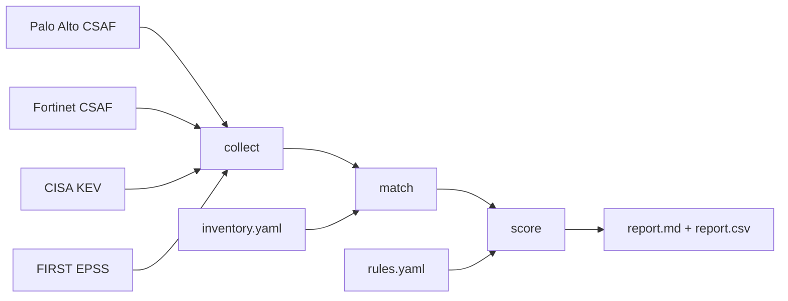

# vuln-triage

[](https://github.com/Achrafelq/vuln-triage/actions/workflows/ci.yml)

Prioritizes Palo Alto and Fortinet vulnerabilities using KEV, EPSS and exposure.

Every morning, a short report that says which firewall to patch first, and why.

## Why

More than 80,000 CVEs were published in 2026 by the end of October ([source](https://www.dexpose.io/cve-2026/)), yet only about 0.24% of those published in the first half of the year were known to be exploited ([source](https://jerrygamblin.com/?p=3528)). Edge devices such as firewalls and VPN gateways are among the most targeted assets, and they cannot run an EDR.

CVSS alone ranks by theoretical severity. `vuln-triage` ranks by what actually matters for a given device: is it exploited, does it apply to this exact version, and is the vulnerable component exposed? See [docs/signals.md](docs/signals.md) for the reasoning.

## How it works



1. **collect** reads the latest vendor advisories (CSAF), then attaches the KEV entry and EPSS score of each CVE.
2. **match** compares every device version with the affected and fixed ranges, branch by branch, hotfix included (`11.1.6` vs `11.1.6-h39`), and detects branches that will never get a fix.
3. **score** assigns P0 to P3, checking the exposure of the component the advisory targets (management interface, VPN portal, authentication portal).
4. **report** writes a Markdown summary and a CSV, including one verified upgrade target per device.

## Example output

```
P0  FW-EDGE-01     CVE-2026-0322     upgrade to 11.1.6-h39
    in KEV since 2026-10-14 · vendor reports active exploitation · management interface exposed · EPSS 1.7% · CVSS 8.6
P2  FW-EDGE-01     CVE-2026-0321     upgrade to 11.1.6-h39
    device exposed to the Internet · EPSS 0.3% · CVSS 8.7
```

| Device | Current | Upgrade to | Fixes |
| --- | --- | --- | --- |
| FW-EDGE-01 | 11.1.6 | 11.1.16-h3 | 8 of 8 CVEs |
| FW-BRANCH-01 | 7.4.8 | 7.4.10 | 3 of 9 CVEs; the others need a branch change |

## Quick start

Requires [uv](https://docs.astral.sh/uv/).

```
git clone https://github.com/Achrafelq/vuln-triage.git
cd vuln-triage
uv sync
uv run vuln-triage run
```

The report is written to `reports/report.md` and `reports/report.csv`, using the fictional devices in `inventory.example.yaml`.

| Command | What it does |
| --- | --- |
| `vuln-triage collect` | Download advisories, KEV and EPSS into `data/advisories.json` |
| `vuln-triage inventory [--live]` | Show devices; with `--live`, read the actual version from each device API |
| `vuln-triage match` | List affected device/CVE pairs |
| `vuln-triage score` | Rank them from P0 to P3, with the reasons |
| `vuln-triage report` | Write `report.md` and `report.csv` |
| `vuln-triage run` | `collect` + `report`, for a daily job |

## Priority rules

The first matching rule wins. Thresholds live in `rules.yaml`.

| Priority | Rule |
| --- | --- |
| P0 | Exploited (KEV or vendor) **and** the vulnerable component is exposed |
| P1 | Exploited but not exposed, **or** EPSS ≥ 10% and exposed |
| P2 | CVSS ≥ 7.0 |
| P3 | Everything else |

## Your own inventory

Copy `inventory.example.yaml` to `inventory.yaml` (ignored by Git) and describe your devices. To read versions from the devices themselves, add `host` and the **name** of an environment variable holding a read-only API key:

```yaml
devices:
  - name: FW-LAB-PA
    vendor: paloalto
    version: "11.1.6"
    internet_facing: true
    mgmt_exposed: false
    vpn_portal_enabled: true
    auth_portal_enabled: false
    host: 192.168.10.1
    secret_env: PA_LAB_KEY
```

```
export PA_LAB_KEY="..."
uv run vuln-triage inventory --file inventory.yaml --live
```

## Design choices

- **No secret in any file.** The inventory refuses fields such as `api_key` or `password`; keys come from environment variables and are sent in HTTP headers, never in URLs.
- **Silence is a bug.** A source that cannot be read is reported at the top of the report instead of being skipped quietly. An unreadable version or a missing exposure flag stops the run.
- **When in doubt, report it.** Matching is conservative: a false positive can be checked, a false negative cannot be seen.
- **Hardened CI.** Read-only workflow token, actions pinned to commit SHAs, no persisted credentials.

## Limitations

- Only recent advisories (vendor RSS feeds), PAN-OS and FortiOS only.
- Exposure is declared in the inventory, not discovered.
- Some Panorama-only advisories are also reported on firewalls.

See [BACKLOG.md](BACKLOG.md) for what is deliberately out of scope.
